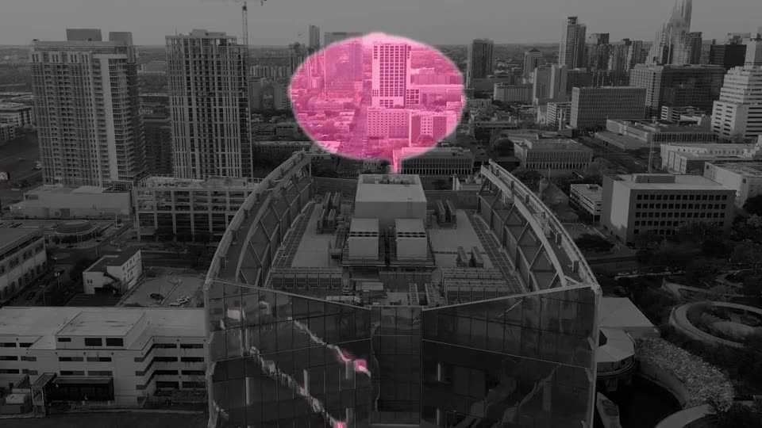

# 🔒 PlateLock — Add the VFX. Keep the shot.

**Open-source generative VFX for ComfyUI.** LTX-2.3 invents the effect; PlateLock composites it onto your
original footage like a VFX artist would — so every pixel the effect doesn't need stays **bit-identical** to
what you shot.

> Built for [#OpenSourceHiggsfield](https://comfy.org/open-source-higgsfield) · 100% open weights · LTX-2.3 · ComfyUI custom node pack · Comfy SDK app · MIT

**▶ Demo video (1:56):** [docs/platelock_demo.mp4](docs/platelock_demo.mp4) · **Live gallery:** https://tushartechs.github.io/platelock/



---

## The problem with AI video effects

Higgsfield's most popular product is its VFX library — explosions, portals, transformations. Every
tool like it (open or closed) works the same way: **the model repaints the entire frame.** Even pixels the
effect never touches come back changed:

- faces and textures drift, fine detail turns to mush
- the background shimmers frame to frame (VAE noise)
- 1080p/4K footage comes back at the model's resolution
- colours shift slightly — enough to ruin a cut against the untouched shot

That's fine for a meme. It's unusable for anyone who needs the shot to stay *their shot*.

## What PlateLock does differently

A compositor never re-renders the actor. They generate the **element**, pull a **matte**, and layer it
over the **original plate**. PlateLock does exactly that, automatically, inside ComfyUI:

| | Raw generative edit | **PlateLock** |
|---|---|---|
| Pixels outside the effect | regenerated (~25 dB PSNR) | **copied bit-for-bit (lossless)** |
| Output resolution | model resolution (1024×576) | **your footage's resolution** |
| Background shimmer / colour drift | yes | **none** |
| Sensor grain on the effect | none (plastic look) | **matched to your camera** |
| Reusable in Nuke / AE / Resolve | no | **alpha + emissive element, X-ray matte** |
| Proof | trust me | **Fidelity Report node measures it** |

### Results (10 shots, LTX-2.3 distilled fp8, 97 frames, L40S, ~2 min/shot)

| Shot | Prompt | Raw LTX, outside effect | PlateLock: bit-identical |
|---|---|---|---|
| 🔮 Energy Orb | *Add a glowing golden orb of swirling energy with crackling sparks, floating just above the open palm.* | 35.6 dB | **89.2%** (lossless) |
| 🔥 My Code Is On Fire | *Add roaring orange flames with drifting embers, burning on the laptop keyboard.* | 33.3 dB | **92.0%** (lossless) |
| 🐉 Pocket Dragon | *Add a small green dragon with spread wings, standing on top of the phone.* | 39.2 dB | **95.8%** (lossless) |
| 🛸 Mothership | *Add a colossal dark alien mothership with glowing blue lights, hovering in the sky above the city skyline.* | 25.8 dB | **93.6%** (lossless) |
| ☄️ Meteor Strike | *Add a flaming meteor with a bright fiery trail and smoke, crashing onto the road in the distance.* | 23.8 dB | **96.1%** (lossless) |
| 🌀 Sky Portal | *Add a swirling glowing blue portal with violet sparks at its edge, opening in the sky between the buildings.* | 24.8 dB | **86.3%** (lossless) |
| 🌊 Sea Serpent | *Add a giant green sea monster head with a long neck, rising from the lake in the center.* | 30.9 dB | **95.2%** (lossless) |
| 🦌 Spirit Deer | *Add a glowing blue spirit deer with shining antlers, standing on the forest path in the center.* | 25.2 dB | **93.4%** (lossless) |
| 💥 Road Explosion | *Add a huge orange fireball explosion with smoke, on the road behind the car.* | 36.6 dB | **90.1%** (lossless) |
| 🪐 Desk Hologram | *Add a small glowing blue hologram of a rotating planet, floating above the open book.* | 32.6 dB | **91.5%** (lossless) |

Average: **92.3%** of every frame bit-identical to the source; raw model output outside the effect: 23.8–39.2 dB PSNR.


## How it works

```
your shot ──► Prep Plate ──► LTX-2.3 EditAnything (open weights, IC-LoRA) ──► generated proxy
   │            (8n+1 frames,                                                       │
   │             1024×576 proxy)                                                    ▼
   │                                              Tone-align: robust per-frame colour fit
   │                                              undoes the model's global drift
   │                                                                                │
   │                                              Difference Matte: noise-adaptive change
   │                                              detection + 3-D (space+time) hysteresis
   │                                                                                │
   │                                              Temporal Stabilize: median + bidirectional
   │                                              agreement (no flicker, no ghost trails)
   │                                                                                │
   └──────────────────────────────► Composite onto Plate: effect upscaled, re-grained,
                                    laid over the FULL-RES original; zero-matte pixels copied
                                    bit-exact ──► comp · X-ray · VFX element · 9:16 share · report
```

### The node pack (`comfyui-platelock/`)

| Node | What it does |
|---|---|
| **PlateLock · Prep Plate** | Trims to LTX's 8n+1 frame rule and makes a /32 model-resolution proxy |
| **PlateLock · Difference Matte** | Finds what the model *added*. Robust tone fit (reduced-major-axis regression, immune to sensor-noise bias) → opponent-colour distance → per-frame noise-floor normalisation → 3-D geodesic hysteresis so weak responses survive only if connected in space *or time* to a strong one |
| **PlateLock · Temporal Stabilize** | Temporal median + forward/backward EMA, keeping only what both directions agree on — damps flicker without smearing fast effects |
| **PlateLock · Refine Matte** | Open / close / grow / feather |
| **PlateLock · Composite onto Plate** | Upscales the effect, re-grains it with the plate's measured noise, composites onto the full-res original; zero-matte pixels are copied bit-exact |
| **PlateLock · Extract VFX Element** | `alpha` (premultiplied, comp *over*) or `emissive` (light the model added, comp *screen/add*) |
| **PlateLock · Fidelity Report** | Measures untouched %, bit-identical %, PSNR outside the effect for raw model vs PlateLock; saves JSON |
| **PlateLock · X-Ray Overlay** | Shows exactly where the model was allowed to touch your shot |
| **PlateLock · Before/After Share** | Animated wipe, reframed 9:16 / 1:1 / 4:5 with blurred fill — made for Reels/TikTok/Shorts |
| **PlateLock · Gamma** | Tiny replacement for the gamma pair the EditAnything template needs (drops a heavy dependency) |
| **PlateLock 🔒 Lock Plate** | All-in-one: matte → stabilise → refine → composite |

The nodes are pure PyTorch (CUDA / MPS / CPU), have no dependencies beyond ComfyUI, and work with **any**
video-to-video model's output — not just LTX. They're unit-tested on synthetic shots with known ground truth
(`comfyui-platelock/tests`).

### The app (`app/`)

A FastAPI + vanilla-JS studio that talks to ComfyUI **only through the Comfy Developer Platform**
(`comfy-sdk` → `comfy-api-proxy` → self-hosted ComfyUI, or Comfy Cloud):

- **Add an effect** — drop a clip, tap a preset (🔮 Energy Orb, 🔥 Set It Ablaze, 🐉 Pocket Dragon, 🛸 Mothership…) or write your own
- **Lock any generation** — bring the original + *any* AI-edited version (from any tool) and PlateLock rescues your plate
- **Compare viewer** — frame-locked split slider, zoom, Original / Raw LTX / PlateLock / X-Ray / Element
- **Fidelity panel** — the numbers, per shot
- **Exports** — final comp, 9:16 share clip, VFX element, X-ray matte

## Run it

**1 · GPU box** (we used a Runpod L40S 48 GB; a 24 GB card works with offloading):

```bash
git clone https://github.com/TusharTechs/platelock && cd platelock
bash scripts/runpod_setup.sh      # ComfyUI + LTXVideo nodes + PlateLock nodes + 44 GB of open weights + comfy-api-proxy
```

Models (all open weights): `ltx-2.3-22b-distilled-fp8` (Lightricks), `gemma_3_12B_it_fp8_scaled`,
`ltx23_edit_anything` IC-LoRA (Alissonerdx).

**2 · The app** (anywhere — your laptop is fine):

```bash
ssh -N -L 8189:127.0.0.1:8189 root@<gpu-host> -p <port>   # or run the app on the GPU box
export COMFY_BASE_URL=http://127.0.0.1:8189
pip install -r app/requirements.txt
python app/run.py                                          # → http://127.0.0.1:7860
```

**Just the nodes:** copy/symlink `comfyui-platelock` into `ComfyUI/custom_nodes`, open
`workflows/platelock_ltx_api.json` (full pipeline) or `workflows/platelock_comp_api.json` (bring your own
generation).

**Static gallery:** `app/web` + `examples/` deploy as-is to GitHub Pages.

## Honest notes

- "Bit-identical" refers to PlateLock's output frames vs the decoded original. Delivery encodes (H.264 in the
  app) are lossy as always; export losslessly if you need it end-to-end.
- The difference matte keeps anything the model *changed* — including legitimate secondary effects like light
  spill and shadows (good), and occasional unwanted model edits (use *Lock tightness* or a region hint).
- EditAnything is an experimental community LoRA; some prompts don't take. PlateLock can't add what the model
  didn't generate — it guarantees it doesn't take away what you shot.

## Credits

LTX-2.3 by Lightricks · EditAnything IC-LoRA by Alissonerdx · ComfyUI by Comfy Org · sample footage from
[Mixkit](https://mixkit.co) (free license; source clips are not redistributed here — `scripts/fetch_footage.sh`).

MIT © 2026
